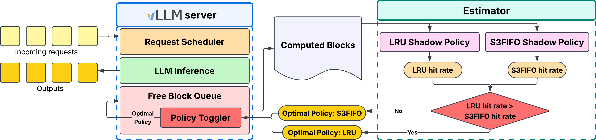
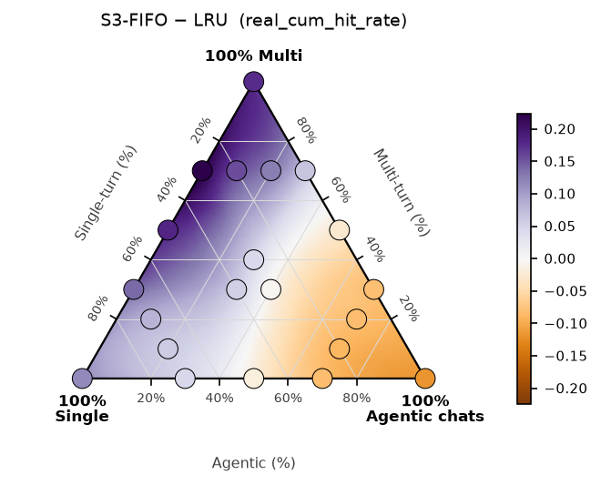
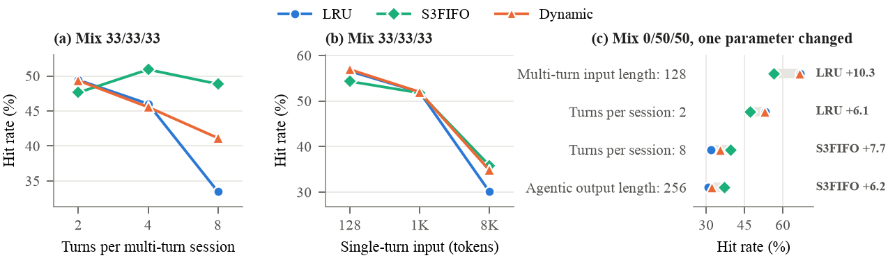

# WAKMan — Workload Aware KV Cache Manager

Prefix caching enables Large Language Model (LLM) servers to reuse the Key-Value (KV) states and accelerate prefill computation for requests that share a prefix with earlier prompts, thus reducing latency and serving cost. With limited memory, the KV cache eviction policy becomes a decisive factor in determining the overall benefits of prefix caching. Production traffic may have single-turn, multi-turn, agentic, or any mixture of these request types. Our findings indicate that agentic steps return within seconds and favor recency, while popular prompts and long conversations return after many other requests and favor frequency. Across 20 mixes, no single policy is always best: vLLM's default LRU provides 12% higher cache hits than the frequency-oriented S3FIFO on agentic-heavy mixes but trails it by up to 22% elsewhere, and even a single workload parameter can flip the winner for a fixed mix. We present WAKMan, a workload-aware KV cache manager that picks its eviction policy from live traffic without knowing request types or reading prompts. It improves hit rate over LRU by 5 percentage points on average, with the lowest mean and worst-case optimality gap of all policies.

📄 Arxiv Preprint: [`WAKMan: Workload Aware KVCache Manager`](https://arxiv.org/abs/2610.36355)

## Method

Every *T* = 15 min, the estimator replays the last window of block hashes (already computed by vLLM) through shadow LRU and S3FIFO policies, and the server switches to whichever had the higher hit rate. No request types, prompt content, or offline training are needed.

## Results

Prefix-cache hit rate (%) on the 20 workload mixes (S/M/A = % single-turn / multi-turn / agentic). **Bold** = best policy per row; Ideal = infinite cache.

<table>
<tr>
<td valign="top">
<table>
<tr><th>Mix S/M/A</th><th>LRU</th><th>S3FIFO</th><th>WAKMan</th><th>Ideal</th></tr>
<tr><td>100/0/0</td><td align="right">37.8</td><td align="right"><b>49.5</b></td><td align="right">46.5</td><td align="right">50.1</td></tr>
<tr><td>70/0/30</td><td align="right">55.3</td><td align="right"><b>60.0</b></td><td align="right">57.4</td><td align="right">70.0</td></tr>
<tr><td>50/0/50</td><td align="right"><b>61.3</b></td><td align="right">59.5</td><td align="right"><b>61.3</b></td><td align="right">76.1</td></tr>
<tr><td>30/0/70</td><td align="right"><b>64.4</b></td><td align="right">56.1</td><td align="right">64.3</td><td align="right">80.3</td></tr>
<tr><td>0/0/100</td><td align="right"><b>69.3</b></td><td align="right">57.6</td><td align="right">69.2</td><td align="right">84.7</td></tr>
<tr><td>70/10/20</td><td align="right">49.8</td><td align="right"><b>55.6</b></td><td align="right">54.0</td><td align="right">66.1</td></tr>
<tr><td>20/10/70</td><td align="right"><b>62.4</b></td><td align="right">53.4</td><td align="right">62.3</td><td align="right">80.3</td></tr>
<tr><td>70/20/10</td><td align="right">43.5</td><td align="right"><b>51.7</b></td><td align="right">49.4</td><td align="right">62.3</td></tr>
<tr><td>10/20/70</td><td align="right">60.4</td><td align="right">52.1</td><td align="right"><b>60.4</b></td><td align="right">80.9</td></tr>
<tr><td>70/30/0</td><td align="right">31.5</td><td align="right"><b>45.4</b></td><td align="right">42.4</td><td align="right">56.9</td></tr>
<tr><td>30/30/40</td><td align="right">50.9</td><td align="right">50.4</td><td align="right"><b>51.1</b></td><td align="right">74.3</td></tr>
<tr><td>30/40/30</td><td align="right">42.8</td><td align="right"><b>47.3</b></td><td align="right">42.8</td><td align="right">73.2</td></tr>
<tr><td>0/30/70</td><td align="right"><b>59.1</b></td><td align="right">51.0</td><td align="right"><b>59.1</b></td><td align="right">81.4</td></tr>
<tr><td>50/50/0</td><td align="right">23.4</td><td align="right"><b>41.4</b></td><td align="right">38.6</td><td align="right">60.4</td></tr>
<tr><td>0/50/50</td><td align="right"><b>49.5</b></td><td align="right">46.8</td><td align="right">49.2</td><td align="right">78.6</td></tr>
<tr><td>30/70/0</td><td align="right">14.2</td><td align="right"><b>36.6</b></td><td align="right">34.1</td><td align="right">63.1</td></tr>
<tr><td>20/70/10</td><td align="right">22.6</td><td align="right"><b>38.3</b></td><td align="right">36.1</td><td align="right">67.6</td></tr>
<tr><td>10/70/20</td><td align="right">27.4</td><td align="right"><b>39.9</b></td><td align="right">37.9</td><td align="right">71.7</td></tr>
<tr><td>0/70/30</td><td align="right">34.3</td><td align="right"><b>40.9</b></td><td align="right">38.3</td><td align="right">75.2</td></tr>
<tr><td>0/100/0</td><td align="right">8.4</td><td align="right"><b>26.0</b></td><td align="right">15.0</td><td align="right">67.1</td></tr>
<tr><td><b>Mean regret</b></td><td align="right">7.09</td><td align="right">2.53</td><td align="right"><b>2.04</b></td><td align="right"></td></tr>
<tr><td><b>Max regret</b></td><td align="right">22.4</td><td align="right">11.7</td><td align="right"><b>11.0</b></td><td align="right"></td></tr>
</table>
</td>
<td valign="middle" align="center">
 
<em>Hit-rate difference (S3FIFO − LRU) across all mixes. Purple: S3FIFO higher; orange: LRU higher.</em>
</td>
</tr>
</table>

- **No static policy wins everywhere:** LRU is best on 8 agentic-heavy mixes; S3FIFO on 12 single-/multi-turn-heavy mixes.
- **Each static policy has a large worst case:** LRU loses up to 22.4 points, S3FIFO up to 11.7.
- **WAKMan is the most robust:** lowest mean and max regret, recovering a median 84% of the LRU–S3FIFO gap. Its worst case (0/100/0) comes from starting on LRU for the first 15 min of a 1-hour trace.

## Ablations

Even with the request mix fixed, a single workload parameter (turns per conversation, input length) flips the better static policy by up to ~15 points. WAKMan uses neither the mix nor these parameters, yet tracks LRU where LRU wins and moves toward S3FIFO where S3FIFO wins.

## Repository layout

- **`analysis/`** — [`paper_figures.ipynb`](analysis/paper_figures.ipynb) regenerates the paper's result
  plots from `experiments/`; figures are saved in `analysis/figures/`.
- **`configs/`** — the golden workload configs.
- **`data/`** — generated workload traces + the generation how-to.
- **`experiments/`** — bare-minimum run artifacts, organized by algorithm
  (`LRU/`, `S3FIFO/`, …).
- **`runner/`** — the launch folder: run perf tests via `run_experiments.sh`
  (with JSON batch specs in `experiment_groups/` and `base_perf_test_configs/`).
- ** `vllm/` ** -  custom vLLM eviction policies implementation.

---

### Authors

- Suhas Kumar Morisetty - Columbia University 
- Vaibhavi Lokegaonkar -  University of Maryland, College Park
- Sachin Mathew Varghese - Capital One
- Wesley Harris - Capital One

